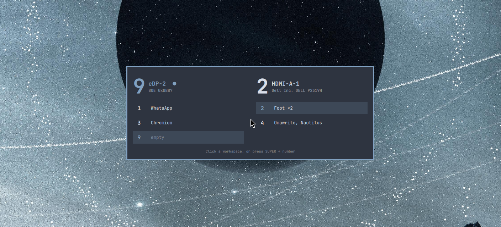

# workspace-peek

[](https://github.com/evertonlm/workspace-peek/actions/workflows/tests.yml)

An [Omarchy](https://omarchy.org) shell plugin that shows **where you are**
on a multi-monitor [Hyprland](https://hypr.land) desk.

- **Hold `SUPER + Z`** to see a card on every monitor with each monitor's
  workspace number, its workspaces and the apps on them. Let go of `SUPER` or
  `Z` (in any order), or press `Esc`, to hide it.
- **Switch workspaces** and the new number flashes on screen for a moment.
- **Click a workspace** in the card to go there.



Hyprland switches workspaces "blind": `SUPER + 3` or `SUPER + TAB` takes you
somewhere without showing where you landed or what is on the other screens.
This plugin fills that gap.

## Install

```bash
omarchy plugin add https://github.com/evertonlm/workspace-peek.git --enable
```

Plugins run as normal code inside `omarchy-shell`, and Omarchy adds them
disabled by default, so read the code first if you like. It is small:
`WorkspacePeek.qml` (the UI) and `PeekModel.js` (the logic).

### Keybindings

Add to `~/.config/hypr/bindings.lua`:

```lua
-- Hold SUPER+Z to peek; release to hide.
hl.bind("SUPER + Z", hl.dsp.exec_cmd([[omarchy-shell shell summon evertonlm.workspace-peek '{"mode":"peek"}']]), { description = "Workspace peek" })
hl.bind("SUPER + Z", hl.dsp.exec_cmd("omarchy-shell shell hide evertonlm.workspace-peek"), { release = true, description = "Hide workspace peek" })
```

`SUPER + Z` is free on a stock Omarchy. Check `omarchy menu keybindings --print`
before picking another key.

Optional: switch workspaces with **`SUPER` + numpad** as well (stock Omarchy only
binds the number row). Both Num Lock states are covered:

```lua
local numpad = {
  { "KP_1", "KP_End" }, { "KP_2", "KP_Down" }, { "KP_3", "KP_Next" }, { "KP_4", "KP_Left" }, { "KP_5", "KP_Begin" },
  { "KP_6", "KP_Right" }, { "KP_7", "KP_Home" }, { "KP_8", "KP_Up" }, { "KP_9", "KP_Prior" }, { "KP_0", "KP_Insert" },
}
for i, keys in ipairs(numpad) do
  for _, key in ipairs(keys) do
    hl.bind("SUPER + " .. key, hl.dsp.focus({ workspace = tostring(i) }), { description = "Switch to workspace " .. i .. " (numpad)" })
  end
end
```

## Settings

Optional file: `~/.config/workspace-peek/settings.json` (reloads on save).

```json
{
  "flashOnSwitch": true,
  "flashDuration": 900
}
```

| Key | Default | Meaning |
|---|---|---|
| `flashOnSwitch` | `true` | Flash the workspace number when you switch |
| `flashDuration` | `900` | How long the flash stays, in milliseconds |

## Commands

```bash
omarchy-shell shell summon evertonlm.workspace-peek '{"mode":"peek"}'   # show the card
omarchy-shell shell summon evertonlm.workspace-peek '{"mode":"flash"}'  # flash the numbers
omarchy-shell shell hide evertonlm.workspace-peek
omarchy-shell shell call evertonlm.workspace-peek state x               # closed | peek | flash
```

While open, the card on the focused monitor holds the keyboard, so it sees
`SUPER` or `Z` being released in any order. (A Hyprland release bind alone only
fires when the whole combo is released in order.) As a last safety net, the
card hides itself after 10 seconds.

## Development

```
manifest.json          Omarchy plugin manifest
WorkspacePeek.qml      overlay windows (one per monitor) and the card
PeekModel.js           pure logic: app names, grouping, summaries, settings
tests/                 node:test unit tests + a live check script
```

```bash
node --test tests/*.test.mjs  # unit tests, no Omarchy needed (also run in CI)
tests/live-check.sh         # against a running Omarchy session
tests/live-check.sh --switch  # also tests the flash on a real workspace switch
```

To hack on it, link your clone into the plugin folder:

```bash
ln -sfn "$PWD" ~/.config/omarchy/plugins/evertonlm.workspace-peek
omarchy-shell shell rescanPlugins && omarchy plugin enable evertonlm.workspace-peek
```

The plugin is `keepLoaded`, so after editing QML run `omarchy restart shell`.
New logic goes in `PeekModel.js`, with a test first.

## Contributing

Issues and pull requests are welcome. `main` is protected: pull requests need
the tests to pass.

## License

[MIT](LICENSE)
